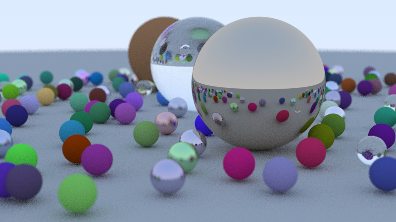

# C++ Ray Tracer

A multithreaded ray tracer written in C++17, with no graphics libraries. It renders photorealistic images of spheres with matte, metal and glass materials, soft shadows, reflections, refraction and camera depth of field.



*800×450, 60 samples per pixel.*

## Features

- **Path tracing:** each pixel fires many random rays that bounce around the scene to simulate real light
- **Three materials:** matte (Lambertian), metal with adjustable fuzz, and glass with refraction, total internal reflection and Schlick's reflectance approximation
- **Positionable camera** with adjustable field of view and depth of field (focus blur)
- **Anti-aliasing** through random sampling within each pixel
- **Multithreaded rendering** with `std::thread`, using a shared atomic row counter so threads stay evenly loaded
- **Command-line options** for resolution, quality and thread count

## Build

With g++:

```bash
g++ -std=c++17 -O2 -pthread src/main.cpp -o raytracer
```

Or with CMake:

```bash
cmake -B build
cmake --build build
```

## Run

```bash
./raytracer                                      # default: 400 px, 50 samples, all cores
./raytracer --width 800 --samples 100 --out scene.ppm
./raytracer --help
```

The output is a PPM image. Open it with an image viewer that supports PPM, or convert it to PNG (for example `magick scene.ppm scene.png`).

## Benchmark: multithreading speedup

| Threads | Render time | Speedup |
| --- | --- | --- |
| 1 | 13.07 s | 1.0× |
| 2 | 8.00 s | 1.6× |
| 4 | 3.16 s | 4.1× |
| 8 | 1.91 s | 6.8× |

Measured with `./raytracer --width 400 --samples 50 --threads N` on 13th Gen Intel(R) Core i7-1355U.

## How it works

1. The **camera** sends rays from its position through each pixel of a virtual screen.
2. Each ray is tested against every **sphere** by solving a quadratic equation for where the ray crosses the sphere's surface.
3. At the closest hit, the surface's **material** decides how the ray scatters: randomly (matte), mirrored (metal) or bent through the surface (glass).
4. The ray keeps bouncing until it escapes to the sky or hits the bounce limit. The color it collects along the way becomes one sample.
5. Many samples per pixel are averaged and gamma-corrected to produce the final image.

## Project structure

```
src/
  main.cpp      scene setup, command-line options, timing
  camera.h      ray generation, multithreaded rendering, image output
  material.h    Lambertian, Metal, Dielectric (glass)
  sphere.h      ray–sphere intersection
  hittable.h    hit record, abstract Hittable, object list
  ray.h         ray definition
  vec3.h        3D vector math
  random.h      thread-safe random numbers
```

## Next steps

- Bounding volume hierarchy (BVH) to speed up rendering of large scenes
- Triangles and loading 3D models
- Textures and emissive light sources

## Credits

Based on the concepts in [*Ray Tracing in One Weekend*](https://raytracing.github.io/) by Peter Shirley, Trevor David Black and Steve Hollasch.
